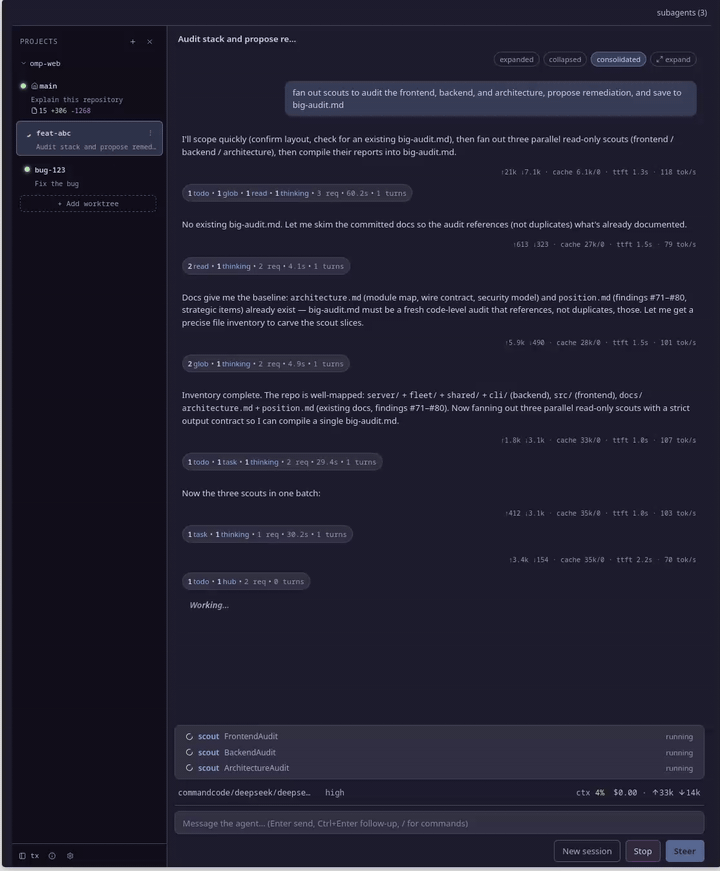

# omp-web

omp-web is a **web UI for running multiple oh-my-pi sessions, across all your repos and worktrees**: one installed command, one browser UI, N agent sessions.

Because it drives the agent through the SDK instead of the RPC, omp-web has full daemon and subagent control; RPC-based GUIs don't.




> **⚠ Early-stage software.** omp-web is under active development and has sharp edges. Expect breaking changes between releases: the wire protocol, config/state formats, and UI are not yet stable. Session transcripts are durable `.jsonl` files. The surrounding tooling (fleet state, config, and managed worktrees) is still evolving; don't treat this as production data storage yet. Report issues and rough spots as you find them.

## Features

- **Multiple Repos and Worktrees, one UI.** Start, monitor, and chat with one agent daemon per worktree across every repo.
- **A full web UI, not a terminal wrapper.** Live-streamed responses, rendered markdown and diffs, tool output, slash commands, prompt history and autocomplete, per-session context/usage meters, and a transcripts/stats view.
- **Custom wire protocol for full SDK control.** The SSE + POST contract carries the full SDK surface, including daemon and subagent control the RPC doesn't expose.
- **Manage repos and worktrees from the UI.** Register projects (deduped by realpath); create owned worktrees or adopt external ones. Owned worktrees delete safely: clean-tree-only, `git branch -d`, no `--force`. Removing a local daemon preserves its files.
- **CLI for automation.** Spawn, stop, remove, inspect, and fan a prompt out to many daemons from the terminal, the same fleet the browser talks to.
- **Self-updating.** `omp-web update` checks GitHub Releases and installs a newer release when available.
- **Self-healing.** Sessions dial out to the control plane and redial it after a restart or a dropped connection; a session with no control plane for 10 minutes shuts itself down. Idle daemons exit after 30 minutes by default and are respawned on demand; crashed daemons restart with bounded backoff; browsers re-attach automatically.

## Runtime

`omp-web` runs the fleet in one process: registry, supervisor, and the web UI, on one port. The split form runs the two halves as separate processes: the control plane alone, and a UI process that serves the web UI and proxies its API calls to the control plane.

```sh
omp-web [--port n] [--open]                          # control plane + UI on http://localhost:4722
omp-web control [--port n]                           # split: control plane only, no UI (default 4722)
omp-web ui [--port n] [--control-port n] [--open]    # split: UI on 4723, proxying to the control plane on 4722
```

Everything binds loopback (127.0.0.1) by default; expose the UI port through your own reverse proxy (for example `tailscale serve` or NetBird). `--open` launches the browser at the UI once it is up (not available on `control`). `--port` selects the listen port; `OMP_FLEET_PORT` selects the default control-plane port. Startup prints one line, `omp-web listening on http://localhost:<port> (<N> sessions)` (`omp-web control listening on …` and `omp-web ui listening on … (control :<port>)` for the split form), then only warnings and errors; `--verbose` adds the state and config paths and every lifecycle event.

Sessions dial out: each session daemon connects to the control plane over the callback pair (an NDJSON upload and an SSE downlink), and the control plane never opens a connection into a session. Sessions behind NAT, in a sandbox, or in a Kubernetes pod with no inbound traffic work the same way. Ctrl+C on `omp-web` or `omp-web control` stops the control plane only; sessions keep running, including a turn in progress, and redial the next control plane with the same credential. Restart the control plane on the same port: a session keeps dialing the address it was given. After a restart, entries show `reconnecting`, then `ready` once their session redials; one that has not redialed within 45 seconds is shown `asleep`. A session with no control plane for 10 minutes (`--control-grace`, or `OMP_SESSION_CONTROL_GRACE`; `0` disables) shuts itself down gracefully, and one whose credential the fleet rejects (revoked, or superseded by a newer generation) shuts down at once. A spawned session that is asleep wakes on attach or prompt, resuming its last transcript; if the previous process is still alive somewhere (for example dialing an old port), the wake fails with "locked by another omp-session" until that process exits or is stopped. `omp-web stop <selector>` asks a session to shut down, terminates a local one, and revokes its credential.

`omp-web session` runs one session daemon (one process, one bound directory, one live agent session, wire API only, no web UI). The fleet spawns local sessions with the default local template; a remote session is enrolled and started on its own host (see below). Callback URLs must be https, except loopback http with `--callback-allow-http`. Non-loopback fleet service requires browser authentication.

Remote sessions: `omp-web enroll <name> [--label k=v] [--cwd dir] [--callback-url url]` creates the roster entry and prints the command to run on the session host, which carries the session's credential. The fleet stores only a digest of that credential. `--callback-url` defaults to the control plane's own `/callback` address (or `OMP_FLEET_CALLBACK_URL`); when the host reaches the control plane through a reverse proxy, point the URL at that proxy. The split UI port proxies `/callback` too. `omp-web provision <name>` runs the configured spawn hook with `OMP_HOOK_NAME`, `OMP_HOOK_LABELS`, and the `OMP_SESSION_CALLBACK_*` variables; the hook succeeds when it exits 0. Local sessions are not mirrored: their transcripts stay on this host (`OMP_SESSION_LOG_MIRROR=0`).

Session daemons are disposable processes; the durable truth is the session `.jsonl` transcript on disk.

## Architecture


See [`AGENTS.md`](AGENTS.md) for the engineering map, wire contract, and import, state, and security boundaries.

## Requirements

- [Bun](https://bun.sh) **1.3.14 or newer** (the runtime and installer). The one-line installer installs Bun when absent; upgrade an existing older installation first.
- The **`omp` CLI** with usable provider credentials and a default model configured: run `omp` to configure it, or `omp login` for an OAuth provider. An interactive first run with no fleet config checks this setup; missing setup warns but does not prevent the fleet from starting. Prompts need a usable model and credentials.

## Install

```sh
# One-liner (bun-only; installs bun >= 1.3.14 if missing):
curl -fsSL https://raw.githubusercontent.com/nibblebot/omp-web/main/scripts/install.sh | sh
```

The installer downloads the latest release tarball, verifies its sha256 against the release manifest, and installs it into a pinned project dir (`~/.omp-web/install/`) with a `~/.bun/bin/omp-web` symlink by default (or `$BUN_INSTALL/bin/omp-web`). Put that bin directory on `PATH`. Then `omp-web update` keeps it current.

## Verify

```sh
omp-web --version
```

Run `omp-web --open` to start the fleet and open the UI in your browser (or run `omp-web` and open its printed URL). Register a repository in the UI, start or select a session, and send a prompt. Local sessions use your ordinary SDK credentials.

## Self-update

```sh
omp-web update                          # install the latest release if newer
omp-web update --check                  # check for an update without installing
omp-web update --version x.y.z          # select a specific newer release
omp-web update --force --version x.y.z  # reinstall or downgrade to a specific release
```

`--version` selects a release for this invocation, not a durable pin; a future bare update still checks the latest release. After updating, stop the running control plane (Ctrl+C) and start it again. Running sessions survive that restart on the code they started with; `omp-web stop all` ends them so the next attach or prompt starts them on the new release.

Upgrading from a release before sessions dialed out: entries added with the removed `omp-web add <url>` cannot connect any more; remove them (`omp-web remove <selector>`) and enroll the host again with `omp-web enroll`. Spawned entries need nothing; they enroll on their next start.

## Configuration and State

- Default data directory: `~/.omp-web/`
- `config.json`: fleet config, loaded read-only; only the interactive first-run offer and operator edits write it. Keys include `templates` (spawn commands), `workspaceDir`, `bind`, `browserAccessToken` (a sha-256 digest, not plaintext), `browserOrigin`, and `trustedProxies`. `OMP_FLEET_CONFIG` selects a different file. Flags such as `--bind`/`--browser-access-token` and env `OMP_FLEET_BIND`/`OMP_FLEET_BROWSER_TOKEN` override file keys; CLI/env browser tokens are plaintext inputs hashed in memory.
- `fleet-state.json`: roster and registered projects as pretty-printed JSON, with atomic writes and an exclusive lifetime pidfile lock. Defaults beside the selected config; `OMP_FLEET_STATE` selects another path.
- `workspaces/`: default creation destination for local worktrees, created as needed or during accepted first-run setup. `--workspace-dir`, `OMP_FLEET_WORKSPACE_DIR`, or config `workspaceDir` select another directory independently of config and state; location never determines ownership. Worktrees use `<workspaceDir>/<repo-basename>/<slug(name)>` directly, with no repository marker or hash disambiguation; an existing target is rejected.
- `logs/` beside the state file: durable lineage-file mirrors streamed over enrolled callback pairs when the fleet log store is available. Local spawned sessions are not mirrored; their transcripts stay in their SDK session directory.
- `session-logs/<daemonId>.log` beside the state file: stdout and stderr of each locally spawned session, appended across restarts and never rotated (`/ctl/sessions/<id>/stderr` and the Debug panel show the last 64 KiB). Delete a file to reclaim space; the next launch recreates it.
- `clones/` beside the selected state file: private volumes for new provider-managed clones. Existing clones keep their persisted volume location and provider administration directory even when `workspaceDir` changes; no automatic move occurs.

Interactive first run can choose a data home and write `config.json` there. If you choose a non-default location, set `OMP_FLEET_CONFIG` to that file for subsequent launches. Config, state, and workspace paths can be configured separately; installed code remains in its installation prefix.

Local worktree ownership is creation provenance, not directory containment. Worktrees created by the fleet are explicitly owned; adopted worktrees are external even inside the default directory. Legacy worktrees with no recorded provenance migrate safely to external in memory and are persisted on the next registry mutation (startup alone does not rewrite state). Changing the default directory neither grants nor revokes ownership. Local **Remove from omp-web** / `omp-web remove` stops and unregisters the daemon without deleting files or the Git worktree; only explicitly owned linked worktrees offer disk deletion, with clean-tree checks and no force. Provider-managed clones retain their separate verified-deletion lifecycle.

## Optional features

The web UI's optional features can be turned on or off per browser in **Settings > Features**. A feature that is off is never downloaded: its code loads only when it is enabled.

- Choices are stored in this browser's local storage (`omp.features`), not in `config.json`. Changes take effect after **Reload to apply**.
- The panel shows each feature's size (gzip and raw) and the total you load: the core plus the enabled features. Sizes come from the production build's `feature-sizes.json`; development builds do not produce it and show no sizes.
- A slash command owned by a disabled feature, such as `/git` under Review, shows a local notice and is never sent to the agent. Enable the feature to use it again.
- Features: Analysis mode, Review (`/git`, `/plan-review`, `/annotations`, `/todo`), Integrations (`/mcp`, `/skills`), BTW (`/btw`, `/btw-history`), Goals (`/goal`, Goals & Loops and Vibe), Advisor, and Debug. All are on by default.

## Develop

```sh
bun install
bun run dev                # Vite HMR + fleet; open the printed ui URL; no managed auth broker
```

Dev auto-opens the browser for interactive graphical local runs; `--open`/`--no-open` override this. Use the printed `ui` URL, not the fleet's potentially stale `dist/` UI. The dev fleet listens on a stable per-worktree port so dev-spawned sessions, which outlive a dev restart, redial it; if that port is taken it picks a free one and says so, and surviving sessions then cannot reconnect until they hit their grace or are stopped. Restart dev-spawned daemons after server edits (`bun run fleet stop all --port <fleet port>` with the port from the dev summary, or stop them from the UI); they are not watched.

Source imports into `lib/` use extensionless `#lib/<path below lib/>`, such as `#lib/wire/protocol`, through root `package.json`'s imports mapping. Keep local imports such as `./helpers` relative. Shared libraries are closed: their repository imports stay inside `lib/`, with no library cycles, enforced by `bun run lint`.

In a linked worktree, `bun run dev` copy-once forks the main worktree's existing **dev** fleet state when available; otherwise it starts empty. Later runs keep the diverged roster. `--state-from <path>` seeds from an explicit state file or directory, while `--fresh` deletes this worktree's existing dev roster and skips seeding. Dev state lives outside the repo at `<data home>/dev-fleets/<slug>-<hash8>/` (worktree basename and sha-256 prefix of its realpath). Config and the managed-workspace root remain shared across dev stacks; a separate dev roster does not isolate workspace storage.

By default, development starts only the fleet and Vite, with no managed auth broker or automatic credential configuration. Production `omp-web` never manages broker startup. Local sessions use the user's ordinary SDK credentials.

### Design system

```sh
bun run design             # component showcase on http://localhost:4799/ (OMP_DESIGN_PORT overrides)
```

`bun run design` opens the App view: the real app in Chat Mode with fixture data. Hold Shift to label the component under the pointer and its ancestors (Ctrl+Shift labels every component), then click a label to inspect it in an isolated iframe. Stories live under `#/stories` (`#/stories/coverage`, `#/stories/<storyId>`).

`apps/design-system/` is a standalone Bun server that bundles the real `apps/web` components (Babel with `babel-preset-solid`) and shows each one with fixture data. No fleet runs behind it: control-plane fetches (`/ctl`, `/auth`) are answered from `apps/design-system/fixtures/routes.ts`, daemon commands and `call()` answers come from story handlers in `apps/design-system/daemon.ts`, and stories seed the shared store through `seed`. The store, the fake daemon, and module-level dialog state reset before every story and variant. In the stories view (`#/stories`) the sidebar is computed from the component graph (`graph.ts`): it starts at `App` and drills down through what each component renders, opening the path to the current story. Where a component renders several pieces from another feature folder, they sit under a folder row for that feature (`chat/`), split again by subfolder (`status/`), so App and ModalHost show a few big pieces rather than every component; `ui/` primitives and the Icons page are listed below the tree, and exported components nothing renders are listed under "Not rendered by App". The search box replaces the tree with a flat list of matches. `#/stories/coverage` lists every exported component and whether it has a story. Refresh the page to rebuild after source edits; restart the server after editing `server.ts` or fixture routes. Add a story by creating `apps/design-system/stories/<feature>/<subfolder>/<Name>.tsx`, mirroring the component's folder, whose default export is a `defineStory(...)` (or an array of them); see `registry.ts` for the contract.

## Advanced

```sh
omp-web session [options]            # run a single-session agent daemon
omp-web sessions                    # roster
omp-web projects                    # registered projects
omp-web spawn <path>                 # start a daemon on a directory
omp-web add-repo <path> [--start]    # register a project (deduped on realpath)
omp-web enroll <name> [--label k=v] [--cwd dir] [--callback-url url]   # enroll a remote session; prints its run command
omp-web provision <name> [--label k=v]                  # enroll via the configured spawn hook
omp-web add-worktree <project> <name> [--no-start]      # create an owned worktree
omp-web add-worktree <project> --existing <path>        # adopt an external one
omp-web stop <selector>
omp-web remove <selector>
omp-web rm-project <project>
omp-web rm-worktree <daemon-id> [--delete-branch]
omp-web prompt <selector> <text> [--wait <ms>]
```

`stop`, `remove`, and `prompt` selectors accept `all`, an exact daemon ID, `label:k=v` (also `tag:k=v`), `project:name`, or name globs with `*` and `?`; quote globs to prevent shell expansion. Project arguments accept a registered project ID, path/realpath, or basename. Control commands connect to loopback; `--port` or `OMP_FLEET_PORT` selects the fleet port (default 4722). `prompt` to an asleep spawned session wakes it first; a remote session must already be connected.

`prompt` submits without waiting unless `--wait <ms>` supplies a result timeout.

See [`CONTRIBUTING.md`](CONTRIBUTING.md) for the checks before a pull request and [`AGENTS.md`](AGENTS.md) for the full engineering map.

## Manual install

Install from this repo (build → pack → install):

```sh
git clone https://github.com/nibblebot/omp-web.git && cd omp-web
bun install
bun run install:omp-web       # build → pack → install into ~/.omp-web/install/
omp-web --version             # verify: prints <version>
```
