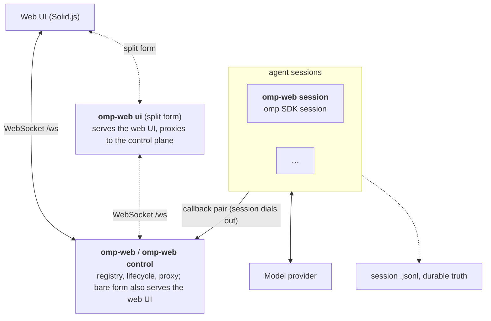

# omp-web

omp-web is a **web UI for running multiple oh-my-pi sessions, across all your repos and worktrees**: one installed command, one browser UI, N agent sessions.

Because it drives the agent through the SDK instead of the RPC, omp-web has full session and subagent control; RPC-based GUIs don't.


Try the [live demo](https://nibblebot.github.io/omp-web/demo/): the real UI in your browser with fixture data, nothing to install.


> **⚠ Early-stage software.** omp-web is under active development and has sharp edges. Expect breaking changes between releases: the wire protocol, config/state formats, and UI are not yet stable. Session transcripts are durable `.jsonl` files. The surrounding tooling (fleet state, config, and worktrees) is still evolving; don't treat this as production data storage yet. Report issues and rough spots as you find them.

## Features

- **Multiple Repos and Worktrees, one UI.** Start, monitor, and chat with one agent session per worktree across every repo.
- **A full web UI, not a terminal wrapper.** Live-streamed responses, rendered markdown and diffs, tool output, slash commands, prompt history and autocomplete, per-session context/usage meters, and a transcripts/stats view.
- **Custom wire protocol for full SDK control.** One WebSocket per browser tab (`GET /ws`) carries the full SDK surface, including session and subagent control the RPC doesn't expose.
- **Manage projects and worktrees from the UI.** Register any directory as a project (deduped by realpath; plain directories get a single row, repositories also get worktrees and branch stats); create worktrees. Deletion removes a local linked worktree only when its tree is clean, with `git branch -d` and no `--force`. As with `git worktree remove`, it also deletes the worktree's Git-ignored files (for example `.env` and `node_modules`). Removing a local session preserves its files.
- **CLI for automation.** Spawn, stop, remove, inspect, and fan a prompt out to many sessions from the terminal, the same fleet the browser talks to.
- **Self-updating.** `omp-web update` checks GitHub Releases and installs a newer release when available.
- **Self-healing.** Sessions dial out to the control plane and redial it after a restart or a dropped connection; a session with no control plane for 10 minutes shuts itself down. Idle sessions exit after 30 minutes by default and are respawned on demand; crashed sessions restart with bounded backoff; browsers re-attach automatically.

## Runtime

`omp-web` runs the fleet in one process: registry, session lifecycle, and the web UI, on one port. The split form runs the two halves as separate processes: the control plane alone, and a UI process that serves the web UI and proxies its API calls to the control plane.

```sh
omp-web [--port n] [--no-open]                       # control plane + UI on http://localhost:4722
omp-web control [--port n]                           # split: control plane only, no UI (default 4722)
omp-web ui [--port n] [--control-port n] [--no-open] # split: UI on 4723, proxying to the control plane on 4722
```

Everything binds loopback (127.0.0.1) by default; expose the UI port through your own reverse proxy (for example `tailscale serve` or NetBird). Bare `omp-web` and `omp-web ui` open the UI in your browser once it is up, but only when run from an interactive local terminal (stdin and stdout TTYs, none of the agent or CI variables `CI`, `CLAUDECODE`, `OMPCODE`, `GEMINI_CLI`, `CODEX_SANDBOX` set, and a display on Linux); scripts, agents (even under a PTY), and service managers never open one, and `--no-open` opts out. `--port` selects the listen port; `OMP_FLEET_PORT` selects the default control-plane port. Startup prints one line, `omp-web listening on http://localhost:<port> (<N> sessions)` (`omp-web control listening on …` and `omp-web ui listening on … (control :<port>)` for the split form), then only warnings and errors; `--verbose` adds the state and config paths and every lifecycle event.

Behind a reverse proxy, the proxy must set the browser origin: the public origin browsers use, passed as `--browser-origin`, env `OMP_FLEET_BROWSER_ORIGIN`, or the config `browserOrigin` key. Set the same value on `omp-web` (or `omp-web control`) and on `omp-web ui`. Without it the fleet refuses a browser Origin that is neither loopback nor that origin, so the UI's mutations fail. Clients that send a request body must set `Content-Type: application/json`; any other media type is refused with 415, so scripts and other HTTP clients need to set it explicitly.

A proxy listed in `trustedProxies` must append the connecting client to `X-Forwarded-For` (or overwrite the header); the fleet reads the header right to left and takes the first hop that is not a trusted proxy. A proxy that forwards a client-supplied `X-Forwarded-For` unchanged lets that client claim any address, including loopback, which skips sign-in.

Sessions dial out: each session process connects to the control plane over the callback pair (one WebSocket, `/callback/ws`; a reverse proxy in front of the control plane must pass the WebSocket upgrade), and the control plane never opens a connection into a session. Sessions behind NAT, in a sandbox, or in a Kubernetes pod with no inbound traffic work the same way. Ctrl+C on `omp-web` or `omp-web control` stops the control plane only; sessions keep running, including a turn in progress, and redial the next control plane with the same credential. Restart the control plane on the same port: a session keeps dialing the address it was given. After a restart, entries show `reconnecting`, then `ready` once their session redials; one that has not redialed within 45 seconds is shown `asleep`. A session with no control plane for 10 minutes (`--control-grace`, or `OMP_SESSION_CONTROL_GRACE`; `0` disables) shuts itself down gracefully, and one whose credential the fleet rejects (revoked, or superseded by a newer generation) shuts down at once. A spawned session that is asleep wakes on attach or prompt, resuming its last transcript; if the previous process is still alive somewhere (for example dialing an old port), the wake fails with "locked by another omp-session" until that process exits or is stopped. `omp-web stop <selector>` asks a session to shut down, terminates a local one, and revokes its credential.

**Reverse proxy or ingress in front of the control plane.** Every session reaches the control plane through `GET /callback/ws`, one long-lived WebSocket per session (there is no renewal and no per-connection byte cap). Anything between a session and the control plane (nginx, Caddy, Envoy, an Istio or Kubernetes ingress, a cloud load balancer, a corporate proxy) must:

- **Pass the WebSocket upgrade** on `/callback/ws`: forward the `Upgrade: websocket` and `Connection: Upgrade` request headers, speak HTTP/1.1 to the upstream, and forward the `Authorization` and `X-Omp-*` request headers unchanged (identity and credential travel in the upgrade request headers, never in the URL). A proxy that strips `Upgrade` answers the upgrade with a plain HTTP response and the session never pairs; its log shows a refused or failed WebSocket dial.
- **Tolerate idle time.** Each side sends a heartbeat message every 15 s (`HEARTBEAT_INTERVAL_MS`) and closes the pair after 30 s without any message (`SILENCE_DEADLINE_MS`), so the pair is never silent for more than about 15 s in either direction. Set the proxy's read, send and idle timeouts for this route above 30 s (60 s or more is a safe margin); a shorter idle timeout drops the pair on every quiet period and the session redials with backoff.
- **Pass messages up to 2 MiB** (`CALLBACK_WS_MAX_PAYLOAD_BYTES`; an envelope is at most 1 MiB) without a lower frame or message size cap.
- **Accept `POST /callback/bulk/<id>` bodies up to 64 MiB** (`BULK_MAX_BYTES`); these downloads and wake transfers are separate plain HTTP requests.

nginx:

```nginx
location /callback/ {
    proxy_pass http://127.0.0.1:4722;
    proxy_http_version 1.1;
    proxy_set_header Upgrade $http_upgrade;
    proxy_set_header Connection "upgrade";
    proxy_read_timeout 120s;
    proxy_send_timeout 120s;
    client_max_body_size 64m;
}
```

Kubernetes ingress-nginx passes the upgrade by itself; raise its timeouts and body limit on the control plane's Ingress: `nginx.ingress.kubernetes.io/proxy-read-timeout: "120"`, `nginx.ingress.kubernetes.io/proxy-send-timeout: "120"`, `nginx.ingress.kubernetes.io/proxy-body-size: "64m"`. Other ingress controllers and gateways have equivalent upgrade and timeout settings; use their WebSocket or upgrade option for `/callback/ws`.

**Reverse proxy or ingress in front of the control plane or the UI listener (browsers).** Every browser tab holds one long-lived WebSocket, `GET /ws` on the page's own origin, for everything it sends and receives (the page's event stream and its commands); `omp-web ui` bridges it to the control plane's `/ws` on loopback. Anything between a browser and the control plane (or `omp-web ui`) must:

- **Pass the WebSocket upgrade** on `/ws`: forward the `Upgrade: websocket` and `Connection: Upgrade` request headers, speak HTTP/1.1 to the upstream, and forward the `Cookie`, `Origin` and `X-Forwarded-For` request headers (the session cookie and the Origin check authenticate the upgrade). A proxy that strips `Upgrade` answers with a plain HTTP response and the page never connects; its network tab shows a failed WebSocket handshake on `/ws`.
- **Tolerate idle time.** The server sends a keepalive message every 15 s (`CLIENT_KEEPALIVE_MS`) and the page closes the socket after 30 s without any message (`CLIENT_SILENCE_DEADLINE_MS`), so the socket is never silent for more than about 15 s. Set the proxy's read, send and idle timeouts for this route above 30 s (60 s or more is a safe margin); a shorter idle timeout drops the socket on every quiet period and the page reconnects with backoff.
- **Pass messages up to about 32 MiB** from the browser (`BROWSER_SOCKET_MAX_PAYLOAD_BYTES`: the largest command plus its envelope) without a lower frame or message size cap, and **not buffer the upstream's messages**: the control plane drops a browser that stops reading for 30 s (close 4503), and a proxy that buffers its upstream hides a stalled browser from that rule.
- **Pass the UI's caching and compression headers through.** The fleet serves hashed `/assets/*` as `Cache-Control: public, max-age=31536000, immutable`, `index.html` and the other unhashed files as `no-cache` with an `ETag` (a reload revalidates and gets `304`), and picks a build-time Brotli or gzip copy of each file by `Accept-Encoding` (`Vary: Accept-Encoding`). `/ctl` JSON over 1 KiB is gzipped for clients that accept it. A proxy that rewrites or drops `Cache-Control`, `ETag`, `Vary` or `Content-Encoding`, or that sends the upstream no `Accept-Encoding`, makes every load download the whole bundle uncompressed (about 1.2 MB instead of about 270 KB).

nginx, in front of the control plane or the UI listener:

```nginx
location /ws {
    proxy_pass http://127.0.0.1:4722;
    proxy_http_version 1.1;
    proxy_set_header Upgrade $http_upgrade;
    proxy_set_header Connection "upgrade";
    proxy_set_header X-Forwarded-For $proxy_add_x_forwarded_for;
    proxy_buffering off;
    proxy_read_timeout 120s;
    proxy_send_timeout 120s;
}
```

Kubernetes ingress-nginx passes the upgrade by itself; raise `nginx.ingress.kubernetes.io/proxy-read-timeout` and `nginx.ingress.kubernetes.io/proxy-send-timeout` to `"120"` on the Ingress that serves the UI. Other ingress controllers and gateways have an equivalent WebSocket or upgrade option and timeout setting.

The other direction: a session that has to leave its network through a proxy resolves the proxy itself, because Bun's WebSocket client ignores `HTTP_PROXY` / `HTTPS_PROXY` / `NO_PROXY` (Bun's `fetch`, used for the bulk POSTs, honors them; the session passes the one resolved proxy to both). It uses the launch payload's explicit `callback.proxy` (`OMP_SESSION_CALLBACK_PROXY` in the callback handoff) when present, else those variables in its own process environment. The fleet does not copy its own proxy variables into a clone or pod: a sandboxed or in-pod session sees only the proxy variables the runtime environment gives it (for a pod, whatever the cluster injects). Only `http://` and `https://` proxies are supported, reached with `CONNECT`; an unsupported scheme is an error, never a silent direct connection. The proxy must allow `CONNECT` to the control plane's port.

Check the path before launching clones: `OMP_FLEET_CALLBACK_URL=https://control.example.com omp-web preflight --profile <id>` opens a real WebSocket upgrade to `<url>/callback/ws` (through the proxy resolved from the fleet's own `HTTP(S)_PROXY` / `NO_PROXY`, as a session with that environment would), carrying no credential. The `callback-ws` row passes when the control plane answers with its typed refusal for the missing credential, and fails with the proxy or ingress setting to fix when the upgrade is refused, never answered, or answered by something that is not the fleet. A host-local session and the fleet's own derived callback URL (`http://<bind>:<port>`) need none of this.

A `--resume` session file that is missing exits 78 before bind (`omp-session: --resume <file>: session file not found`) and is never created. The fleet passes plain `--resume` only for a file the session has reported persisted, so a transcript that was written and later deleted fails with 78 and its row parks asleep with that reason. A file the fleet never saw persisted (a session that had no messages yet) relaunches with `--resume <file> --resume-unwritten`, which adopts that path as the same not-yet-written session. An explicitly picked file always resumes strictly. A transcript that exists but cannot be restored exits 78 instead of starting empty; its row stays asleep with the session's reason and is never restarted. A provider-managed clone wake resumes the same way through `OMP_SESSION_RESUME` (strict; `OMP_SESSION_RESUME_UNWRITTEN=1` for a file not known to be written): a bwrap clone gets the host path of the newest session, a Kubernetes clone the in-pod path of the session its runtime last reported (or an explicitly picked stored session), and a first start gets none.

`omp-web session` runs one session process (one process, one bound directory, one live agent session, wire API only, no web UI). The fleet spawns sessions with the default local template. Callback URLs must be https, except loopback http, which the fleet enables for its own loopback bind (the session reads `callback.allowHttp` from its `--fleet-stdin` payload). Non-loopback fleet service requires browser authentication. A standalone session (started without `--fleet-stdin`) also serves the browser socket itself on `GET /ws` for direct clients: loopback peers need no token but a cross-site dial (foreign `Host`, `Origin` or `Sec-Fetch-Site`) is closed 4403, and an off-loopback client passes the token as the `token` query parameter or an `Authorization: Bearer` header. A fleet-managed session binds no listener.

Local sessions are not mirrored: their transcripts stay on this host (`OMP_SESSION_LOG_MIRROR=0`).

Session processes are disposable; the durable truth is the session `.jsonl` transcript on disk.

## Android and installing as an app

The web UI is an installable web app (manifest, icons, and a notification-only service worker with no offline cache). Chrome on Android installs, shows notifications, and registers the worker only in a secure context: HTTPS, or `http://localhost` / `http://127.0.0.1`. A plain `http://<lan-ip>:<port>` address is not a secure context, so there is no install option or notification permission there, and browser sign-in cannot complete either (the session cookie is `Secure` off loopback).

- **HTTPS through a proxy.** Put the UI port behind an HTTPS reverse proxy (`tailscale serve --bg 4722`, NetBird, or your own) and pass the public origin as `--browser-origin` (see Runtime). Open that address in Chrome and choose Install app (or Add to Home screen).
- **USB debugging.** With the phone attached, `adb reverse tcp:4722 tcp:4722` makes `http://localhost:4722` on the phone reach this machine. `localhost` is a secure context, so install and notifications work there for testing.
- **Behind a login proxy.** The manifest link requests credentials (`crossorigin="use-credentials"`), so a proxy that gates the whole origin (Cloudflare Access and similar) can serve it to a signed-in browser.
- **Notifications.** The "Browser Notification Permission" toggle in Web UI settings shows alerts for other sessions through the service worker, which is the only path Android Chrome supports. An alert is raised by the open page, so it needs the app's connection to be alive; a frozen or discarded app raises none, because that would need web push, which omp-web does not use.
- **Updates.** The shell, manifest, and worker are served `Cache-Control: no-cache`; hashed bundles are cached for a year. A new release loads on the next launch. If the app reports it is out of date with the server, use the Reload button in the connection strip.

## Architecture



See [`docs/architecture.md`](docs/architecture.md) for how the browser, fleet and session protocols fit together over time, and [`AGENTS.md`](AGENTS.md) for the engineering map, wire contract, and import, state, and security boundaries.

## Requirements

- [Bun](https://bun.sh) **1.3.14 or newer** (the runtime and installer). The one-line installer installs Bun when absent; upgrade an existing older installation first.
- The **`omp` CLI** with usable provider credentials and a default model configured: run `omp` to configure it, or `omp login` for an OAuth provider. An interactive first run with no fleet config checks this setup; missing setup warns but does not prevent the fleet from starting. Prompts need a usable model and credentials.

## Install

```sh
# One-liner (bun-only; installs bun >= 1.3.14 if missing):
curl -fsSL https://raw.githubusercontent.com/nibblebot/omp-web/main/scripts/install.sh | sh
```

The installer downloads the latest release tarball, verifies its sha256 against the release manifest, and installs it into a pinned project dir (`~/.omp-web/install/`) with a `~/.bun/bin/omp-web` symlink by default (or `$BUN_INSTALL/bin/omp-web`). Put that bin directory on `PATH`. Then `omp-web update` keeps it current.

## Verify

```sh
omp-web --version
```

Run `omp-web` in a terminal to start the fleet and open the UI in your browser (elsewhere, open its printed URL). Register a repository in the UI, start or select a session, and send a prompt. Local sessions use your ordinary SDK credentials.

## Self-update

```sh
omp-web update                          # install the latest release if newer
omp-web update --check                  # check for an update without installing
omp-web update --version x.y.z          # select a specific newer release
omp-web update --force --version x.y.z  # reinstall or downgrade to a specific release
```

`--version` selects a release for this invocation, not a durable pin; a future bare update still checks the latest release. After updating, stop the running control plane (Ctrl+C) and start it again. Running sessions survive that restart on the code they started with; `omp-web stop all` ends them so the next attach or prompt starts them on the new release.

## Custom themes

Theme files live in `<config dir>/themes/<stem>.json` (`~/.omp-web/themes/` by default; the stem is the theme id and must match `[a-z0-9-]+`). The control plane reads the directory on every `GET /ctl/themes` and never writes to it; a file named after a built-in replaces that built-in. Validate a file before dropping it in:

```sh
omp-web theme check ~/.omp-web/themes/my-theme.json
```

It prints schema errors, contrast warnings and the resolved tokens per variant. Exit status is 1 on schema errors (including invalid JSON, a bad stem or a non-`.json` name), 2 for a usage error or unreadable file, and 0 otherwise (warnings are informational).

## Configuration and State

- Default data directory: `~/.omp-web/`
- `config.json`: fleet config, loaded read-only; only the interactive first-run offer and operator edits write it. Keys include `templates` (spawn commands), `workspaceDir`, `bind`, `browserAccessToken` (a sha-256 digest, not plaintext), `browserOrigin`, and `trustedProxies`. `OMP_FLEET_CONFIG` selects a different file. Flags such as `--bind`/`--browser-access-token` and env `OMP_FLEET_BIND`/`OMP_FLEET_BROWSER_TOKEN` override file keys; CLI/env browser tokens are plaintext inputs hashed in memory.
- `fleet-state.json`: roster and registered projects as pretty-printed JSON, written atomically with the file and its directory fsynced, under an exclusive lifetime pidfile lock. Each write keeps the state it replaces as `fleet-state.json.bak`; if the main file is corrupt at startup, the fleet loads the backup, logs that it did, and rewrites the main file on the next change. Writes are coalesced (a burst of status changes shares one write, pending changes flush on shutdown). Defaults beside the selected config; `OMP_FLEET_STATE` selects another path.
- `workspaces/`: default creation destination for local worktrees, created as needed or during accepted first-run setup. `--workspace-dir`, `OMP_FLEET_WORKSPACE_DIR`, or config `workspaceDir` select another directory independently of config and state. Worktrees use `<workspaceDir>/<repo-basename>/<slug(name)>` directly, with no repository marker or hash disambiguation; an existing target is rejected.
- `logs/` beside the state file: durable lineage-file mirrors streamed over enrolled callback pairs when the fleet log store is available. Local spawned sessions are not mirrored; their transcripts stay in their SDK session directory.
- `session-logs/<workspaceId>.log` beside the state file: stdout and stderr of each locally spawned session, appended across restarts. A launch that finds the file above 1 MiB renames it to `<workspaceId>.log.1` (one older generation kept, replaced on the next rotation), and a single run rotates the same way at 1 MiB. `/ctl/sessions/<id>/stderr` and the Debug panel show the last 64 KiB of the file. Deleting or pruning a session removes both generations; the next launch recreates the file.
- `clones/` beside the selected state file: private volumes for new provider-managed clones. Existing clones keep their persisted volume location and provider administration directory even when `workspaceDir` changes; no automatic move occurs.

Interactive first run can choose a data home and write `config.json` there. If you choose a non-default location, set `OMP_FLEET_CONFIG` to that file for subsequent launches. Config, state, and workspace paths can be configured separately; installed code remains in its installation prefix.

`omp-web remove` stops and unregisters the session without deleting files or the Git worktree. Linked worktrees of a registered project offer disk deletion, with clean-tree checks, no force, and removal of their Git-ignored files. Provider-managed clones retain their separate verified-deletion lifecycle.

A project is any directory, not only a Git repository. A plain directory gets one row for its folder, with the session title and the usual session controls, and no worktrees, clones, branch, or diffstat; `omp-web add-worktree` against it fails with "project is not a git repository". Adding a `.git` later is detected automatically and the project becomes a repository, and removing it reverts the project to a plain directory: its main row stays, shown without Git details, and its linked worktree rows are removed from the sidebar (transcripts kept), a running one once it stops. A directory inside a repository, or a linked worktree, still registers as that repository's main checkout; bare repositories are refused. `git init` in a parent directory of a plain project is not detected.

Worktree discovery is watcher-driven: the fleet watches each project's directory and, for repositories, `.git/worktrees`, so a worktree added from a terminal appears in the sidebar within about a second. When the filesystem gives no events (for example some network mounts), the fleet logs the reason once and polls that project every 60 s instead. Asleep rows are not re-probed: their branch, diffstat, and title stay as they were until the row wakes.

Clones cut from the project's local path on a fleet-readable volume (bwrap or host) have a **Fetch into project** row action, also `POST /ctl/clones/<workspaceId>/fetch-into-project`. It fetches the clone's own branch (the branch named after the workspace) from its checkout into the project's main repo: a missing branch is created and an existing one is fast-forwarded, never overwritten. The fleet refuses, and leaves the project untouched, when the project's branch has commits the clone's lacks (not a fast-forward) or is checked out in any worktree of the project (switch that checkout away first). Only committed work travels; uncommitted changes stay in the clone. Remote-source and Kubernetes clones push upstream from inside their runtime and do not offer the action.

Provider-managed clones run on a provider profile from the config file's `providerProfiles` map, offered as the **Run on** choice of the New workspace popover. The profile `provider` is one of `bwrap` (a bubblewrap sandbox on the fleet host), `kubernetes` (a pod with a persistent volume claim), or `host`. A `host` profile has no `executable` and no limits, only an optional `secretRefs`:

```json
{ "providerProfiles": { "host-dev": { "provider": "host" } } }
```

A **host clone** gets the same private volume, checkout, home, callback handoff, verified delete gate, wake resume, Fetch into project and log mirror as a bwrap clone, and its source is the project's local path or a remote URL. The difference is that nothing isolates it: **there is no sandbox**. Its `omp-session` runs as the fleet user, on the fleet host, with that user's filesystem, network and credentials, so the agent in it can read and change anything the fleet user can, including the operator's home directory and credentials. Its environment and `HOME` layout match a bwrap clone's (a fixed allowlist of variables, `HOME` set to the volume's `.home`), but that is layout, not containment. Use a host profile only for repositories and agents you would run directly on this machine; use `bwrap` or `kubernetes` when the agent must be contained. The provider operation protocol and the per-kind capabilities are described in [`docs/provider-protocol.md`](docs/provider-protocol.md).

## Optional features

The web UI's optional features can be turned on or off per browser in **Settings > Features**. A feature that is off is never downloaded: its code loads only when it is enabled. Features that default to on (Plugins, Debug Sheet) load in the background after the page has rendered, and their chunks are fetched alongside the app entry unless this browser turned them off.

- Choices are stored in this browser's local storage (`omp.features`), not in `config.json`. A change loads or unloads its feature at once, without a reload; the attached session, draft, and open sheets are kept.
- The panel shows each feature's size (gzip and raw) and the total you load: the core plus the enabled features. Sizes come from the production build's `feature-sizes.json`; development builds do not produce it and show no sizes.
- A slash command owned by a disabled feature shows a local notice and is never sent to the agent; enable the feature to use it again. A command owned by a feature that is in development, such as `/git` under Git Review or `/plan` under Plan Mode, shows a notice saying so, with no way to enable it.
- Unknown commands and terminal-only commands, such as `/collab` and `/live`, show a local notice and are never sent to the agent. `/help` (also under the keyboard shortcuts) lists the commands available in the browser.
- Features: Plugins (a Plugins tab in the Extensions dialog) and Debug are on by default and can be turned off. Analysis mode, Plan Mode (`/plan`, `/plan-review`), Git Review (`/git`, `/annotations`), and Todos (`/todo` and its subcommands, the editable todo list sheet) are in development: they are listed in Settings > Features as "In development" but stay off and cannot be turned on, and their commands show a local notice instead of running. The todo tool cards still show in the transcript while Todos is in development. If plan mode is already on in a session (started from the terminal), the session bar shows a read-only badge for it. BTW, Goals, Advisor, MCP servers, Skills, and Background Jobs are not features: they are always available. `/btw` opens one sheet for the question, answer, history, and promote to transcript. `/goal` and the goal badge open one dialog for the objective, token budget, loops, and Vibe workers. Advisor notes render in the transcript, and the card's Open advisor button opens the advisor sheet. `/mcp` and `/skills` open the Extensions dialog on that group. A status line above the composer shows the turn's progress text (the working intent while the agent streams, "Compacting context…" while it compacts) and, while they have items, Subagents, Jobs, Daemons and Todo buttons with their active counts; each opens a condensed popover. The Activities panel (Alt+A, the command palette, or a popover's popout icon) holds the same sections in full: Subagents (the tree, with each agent's transcript and steer composer), Jobs (background jobs other than subagents' task jobs, with Cancel on the session's own running jobs), Daemons (supervised background processes the session reported, with restart, kill and log) and Todo (the agent's read-only checklist). A toggle switches between an accordion, where any number of items expand in place, and a detail view that fills the panel with one subagent or job. The panel's state is saved per workspace, and `#/w/<id>[/s/<sessionId>]/activities[/<subagent|job>/<id>]` links to it. `/jobs` still runs the agent's own `/jobs`.

## Develop

```sh
bun run dev                # bun install, first-run setup if unconfigured, then Vite HMR + fleet; open the printed ui URL
```

Dev opens the browser only when run from an interactive local terminal with a display and without `--host`; `--no-open` disables it. Use the printed `ui` URL, not the fleet's potentially stale `dist/` UI. Dev-spawned sessions run with a 2s `--control-grace` (production keeps 10 minutes), so they shut themselves down about 2 seconds after dev stops, however it stops. The dev fleet listens on a stable per-worktree port, so a dev restart within that window lets them redial; if that port is taken it picks a free one and says so, and the surviving sessions then exit at the end of their grace. Restart dev-spawned sessions after server edits (stop them from the UI, or restart dev and wait out the grace); they are not watched.

`bun run dev --host` serves Vite on the LAN. Vite's proxy re-presents each LAN page's same-origin request to the loopback fleet, so dev needs no browser origin; `--allow-hosts` still decides which Host names Vite accepts. Only same-origin requests are re-presented: a cross-site Origin still reaches the fleet unchanged and is refused.

Source imports into `lib/` use extensionless `#lib/<path below lib/>`, such as `#lib/wire/protocol`, through root `package.json`'s imports mapping. Keep local imports such as `./helpers` relative. Shared libraries are closed: their repository imports stay inside `lib/`, with no library cycles, enforced by `bun run lint`.

In a linked worktree, `bun run dev` copy-once forks the main worktree's existing **dev** fleet state when available; otherwise it starts empty. Later runs keep the diverged roster. `--state-from <path>` seeds from an explicit state file or directory, while `--fresh` deletes this worktree's existing dev roster and skips seeding. Dev state lives outside the repo at `<data home>/dev-fleets/<slug>-<hash8>/` (worktree basename and sha-256 prefix of its realpath). Config and the managed-workspace root remain shared across dev stacks; a separate dev roster does not isolate workspace storage.

By default, development starts only the fleet and Vite, with no managed auth broker or automatic credential configuration. Production `omp-web` never manages broker startup. Local sessions use the user's ordinary SDK credentials.

### Design system

```sh
bun run design             # component stories on http://localhost:4799/ (OMP_DESIGN_PORT overrides)
bun run demo               # App demo on http://localhost:4798/ (OMP_DEMO_PORT overrides)
bun run build:demo [dir]   # static App demo (default apps/design-system/dist/)
```

The two are standalone pages that do not link to each other, and each opens in the default browser on start when run from an interactive local terminal with a display, never when an agent or CI runs it (same rule as `omp-web`). `bun run design` serves the stories: a sidebar of every component story, with routes under `#/stories` (`#/stories/coverage`, `#/stories/<storyId>`). `bun run demo` serves the App view: the real app in Chat Mode with fixture data. Hold Shift to label the component under the pointer and its ancestors (Ctrl+Shift labels every component), then click a label to inspect it in an isolated iframe. `bun run build:demo` writes the same demo page as a static site (`index.html`, `main.js`, `main.css`, minified, no sourcemap) that works from any path; the GitHub Pages workflow (`.github/workflows/pages.yml`) publishes it at https://nibblebot.github.io/omp-web/demo/ next to the docs site at https://nibblebot.github.io/omp-web/docs/ on every push to `main`.

`apps/design-system/` is a standalone Bun server that bundles the real `apps/web` components (Babel with `babel-preset-solid`) and shows each one with fixture data. No fleet runs behind it: control-plane fetches (`/ctl`, `/auth`) are answered in the page from `apps/design-system/fixtures/routes.ts` (the server only serves the page and its bundle), session commands and `call()` answers come from story handlers in `apps/design-system/session.ts`, and stories seed the shared store through `seed`. The store, the fake session, and module-level dialog state reset before every story and variant. On the stories page the sidebar is computed from the component graph (`graph.ts`): it starts at `App` and drills down through what each component renders, opening the path to the current story. Where a component renders several pieces from another feature folder, they sit under a folder row for that feature (`chat/`), split again by subfolder (`status/`), so App and ModalHost show a few big pieces rather than every component; `ui/` primitives and the Icons page are listed below the tree, and exported components nothing renders are listed under "Not rendered by App". The search box replaces the tree with a flat list of matches. `#/stories/coverage` lists every exported component and whether it has a story. Refresh the page to rebuild after source edits; restart the server after editing `server.ts` or fixture routes. Add a story by creating `apps/design-system/stories/<feature>/<subfolder>/<Name>.tsx`, mirroring the component's folder, whose default export is a `defineStory(...)` (or an array of them); see `registry.ts` for the contract.

## Advanced

```sh
omp-web session [options]            # run a single-session agent process
omp-web sessions                    # roster
omp-web projects                    # registered projects
omp-web spawn <path>                 # start a session on a directory
omp-web add-project <path> [--start]    # register a project: any directory, git or not (deduped on realpath)
omp-web add-worktree <project> <name> [--no-start]      # create a worktree
omp-web stop <selector>
omp-web remove <selector>
omp-web rm-project <project>
omp-web rm-worktree <workspace-id> [--delete-branch <name>]
omp-web prompt <selector> <text> [--wait <ms>]
omp-web relay --port <n> [--hostname h] [--max-guests n] [--max-rooms n]   # run the standalone collab relay
```

`stop`, `remove`, and `prompt` selectors accept `all`, an exact workspace ID, `project:name`, or name globs with `*` and `?`; quote globs to prevent shell expansion. Project arguments accept a registered project ID, path/realpath, or basename. Control commands connect to loopback; `--port` or `OMP_FLEET_PORT` selects the fleet port (default 4722). `prompt` to an asleep session wakes it first.

`prompt` submits without waiting unless `--wait <ms>` supplies a result timeout.

`relay` serves collab rooms on its own port (`ws://<host>:<port>`). A session hosts a room through it when `collab.relayUrl` names that URL; `--port` has no default.

See [`CONTRIBUTING.md`](CONTRIBUTING.md) for the checks before a pull request and [`AGENTS.md`](AGENTS.md) for the full engineering map.

## Manual install

Install from this repo (build → pack → install):

```sh
git clone https://github.com/nibblebot/omp-web.git && cd omp-web
bun install
bun run install:omp-web       # build → pack → install into ~/.omp-web/install/
omp-web --version             # verify: prints <version>
```
