# omp-web

omp-web is a **web UI for running multiple [oh-my-pi](https://github.com/can1357/oh-my-pi) sessions across all your repos and worktrees**. It is the omp SDK in your browser: many sessions, any device, sessions that outlive the tab.

<p align="center"><a href="https://nibblebot.github.io/omp-web/demo/"></a></p>

<a href="https://nibblebot.github.io/omp-web/demo/"><picture><source media="(prefers-color-scheme: dark)" srcset="docs/screenshots/hero-dark.webp">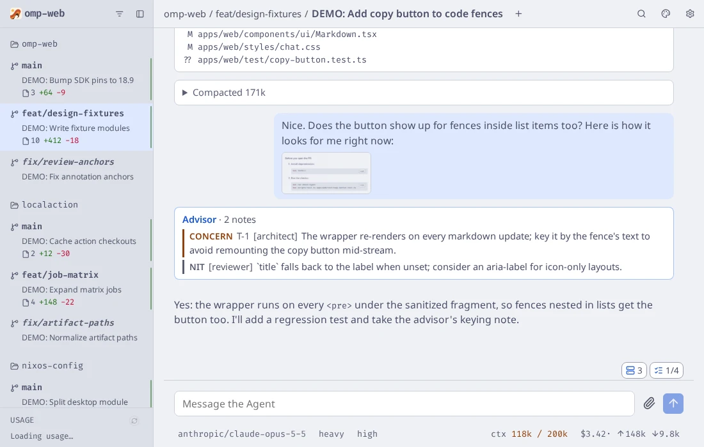</picture></a>

> **Early-stage software.** Expect breaking changes between releases. Session transcripts are durable `.jsonl` files; fleet state and config formats are not yet stable.

## Every project, every worktree in one UI

- Register any directory as a project; repositories list every worktree, each with its own agent session.
- See at a glance which sessions are working, idle or asleep, with their branch and diff stats.
- Create a worktree from any branch without leaving the sidebar; deleting one requires a clean tree.
- Keep the usage left on every provider account in view.
- Idle sessions sleep after 30 minutes and wake when you open them; a crashed session restarts on its own.

<table>
<tr>
<td valign="top" width="34%"><picture><source media="(prefers-color-scheme: dark)" srcset="docs/screenshots/fleet-sidebar-dark.webp">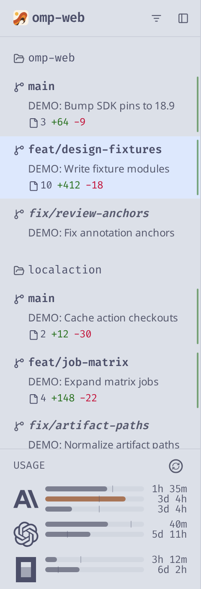</picture></td>
<td valign="top" width="66%"><picture><source media="(prefers-color-scheme: dark)" srcset="docs/screenshots/new-workspace-popover-dark.webp">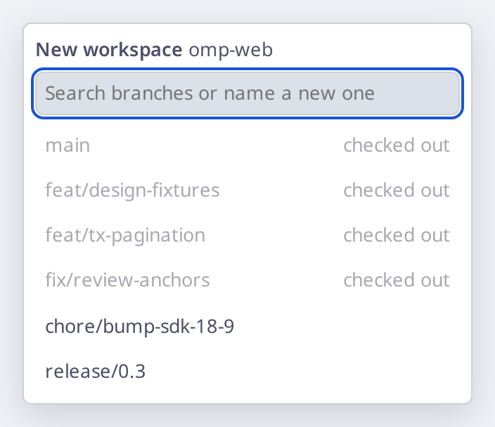</picture></td>
</tr>
</table>

## Access omp sessions from desktop, tablet, or mobile

<table>
<tr>
<td valign="middle" width="60%">

- **Sessions live on your machine**, not in the tab. Close it; the agent keeps working.
- **Any device:** desktop, tablet or phone, in any browser.
- **Switch mid-turn:** pick the same session up on another device and it catches up on what you missed.
- **Other machines:** put omp-web behind `tailscale serve` or any reverse proxy ([Reverse proxies and ingress](https://nibblebot.github.io/omp-web/docs/reverse-proxies/)).

<picture><source media="(prefers-color-scheme: dark)" srcset="docs/screenshots/devices-dark.svg">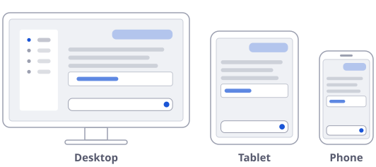</picture>

</td>
<td valign="top" width="40%"><picture><source media="(prefers-color-scheme: dark)" srcset="docs/screenshots/hero-phone-dark.webp">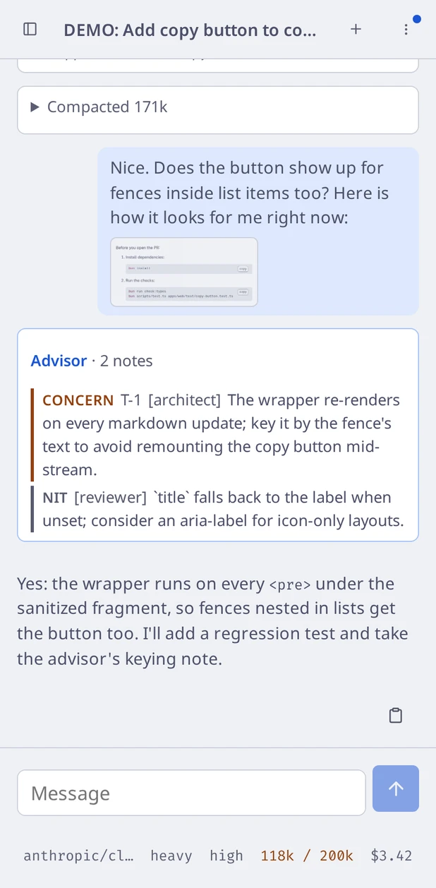</picture></td>
</tr>
</table>

<table>
<tr>
<td valign="top" width="33%"><picture><source media="(prefers-color-scheme: dark)" srcset="docs/screenshots/phone-transcript-dark.webp">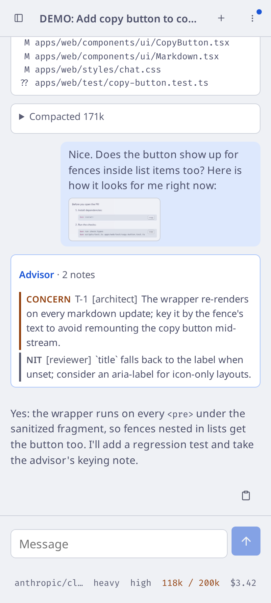</picture></td>
<td valign="top" width="33%"><picture><source media="(prefers-color-scheme: dark)" srcset="docs/screenshots/phone-sidebar-dark.webp">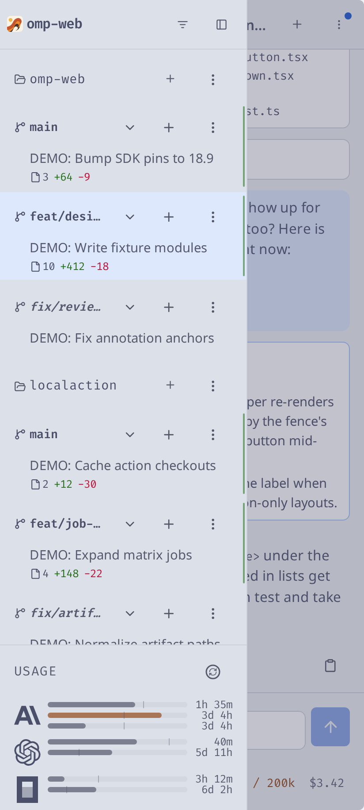</picture></td>
<td valign="top" width="33%"><picture><source media="(prefers-color-scheme: dark)" srcset="docs/screenshots/phone-activities-dark.webp">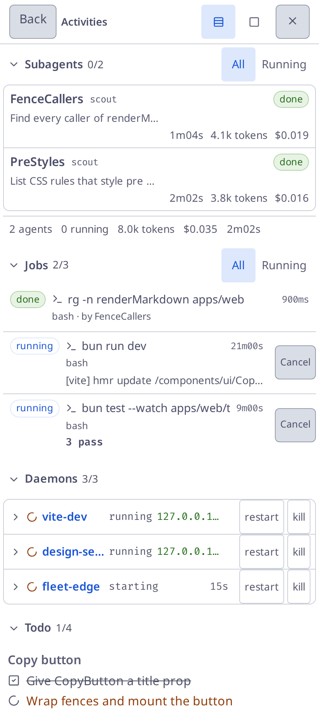</picture></td>
</tr>
</table>

## Activities panel: subagents, daemons, background jobs and todos in one panel

Alt+A opens every subagent with its live transcript and report, every background job and daemon with its output, and the agent's todo list, beside the transcript.

<table>
<tr>
<td valign="top" width="50%"><picture><source media="(prefers-color-scheme: dark)" srcset="docs/screenshots/activities-subagents-jobs-dark.webp">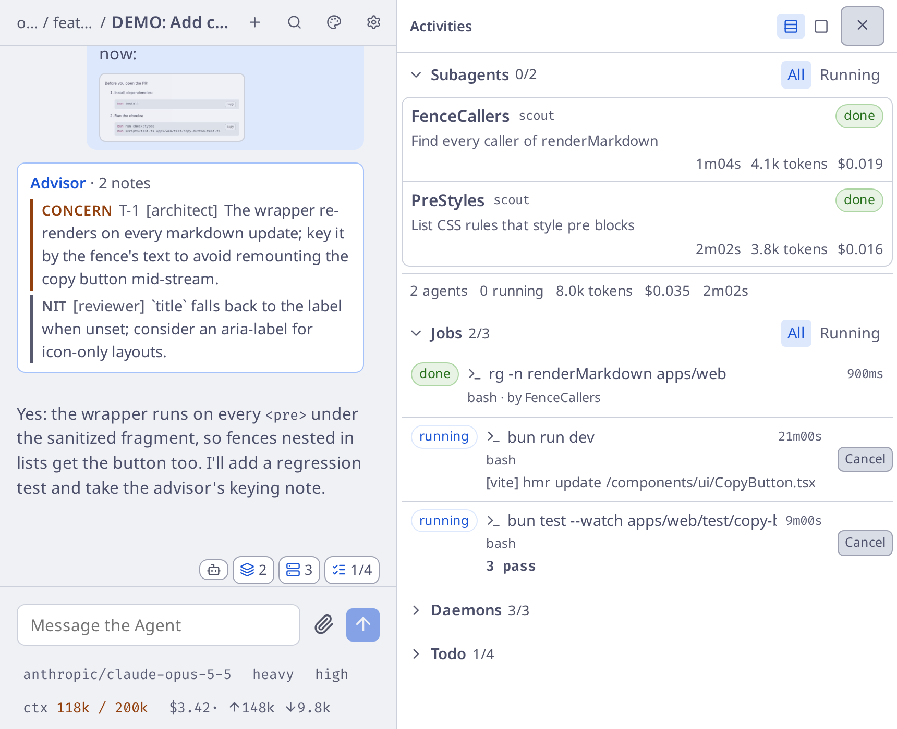</picture></td>
<td valign="top" width="50%"><picture><source media="(prefers-color-scheme: dark)" srcset="docs/screenshots/activities-daemons-todos-dark.webp">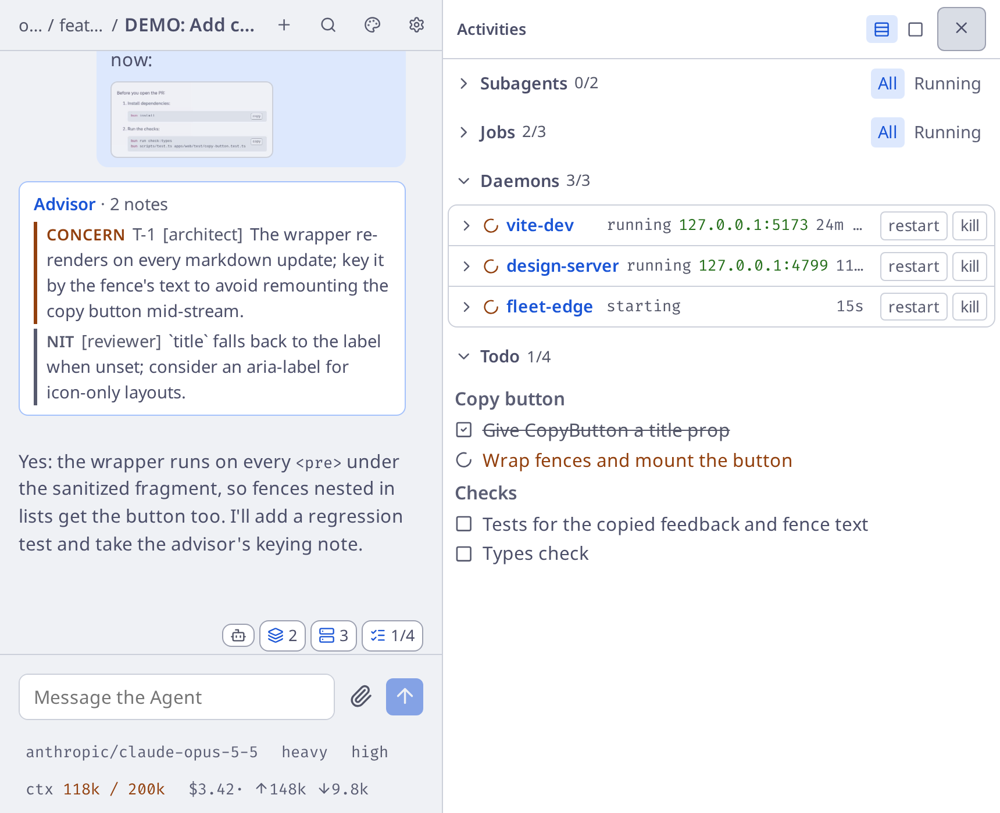</picture></td>
</tr>
</table>

## Command Palette

Ctrl+K searches commands, sessions in every project, settings and models in one list.

<picture><source media="(prefers-color-scheme: dark)" srcset="docs/screenshots/command-palette-dark.webp">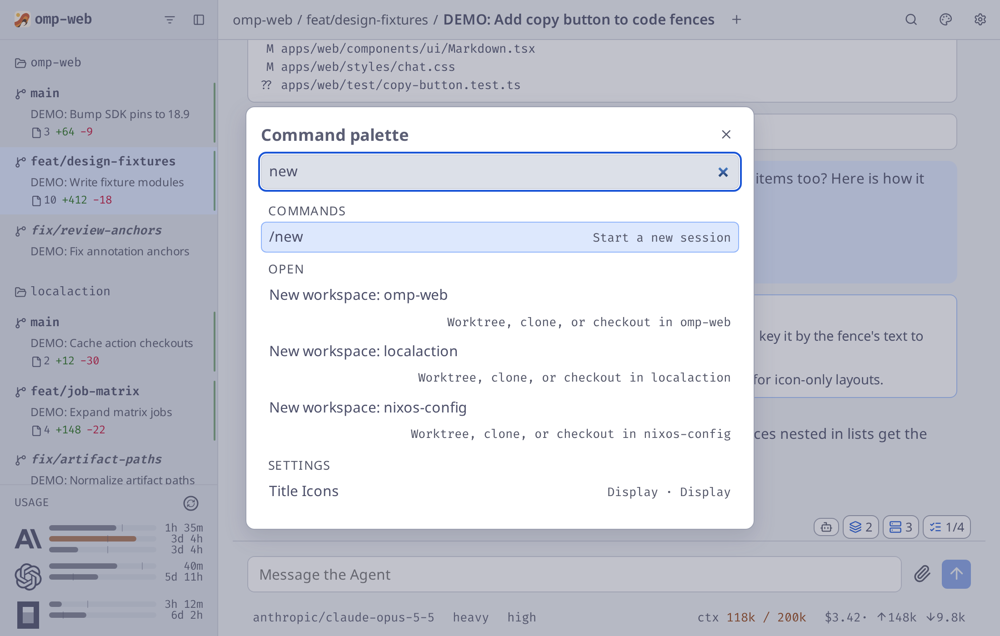</picture>

## Everything the TUI does, in a browser

Subagent control, background jobs, model presets and roles, settings and themes work as they do in the omp TUI.

### Every built-in tool, rendered

<table>
<tr>
<td valign="top" width="50%"><b>Ask</b><br>Questions with options; your answers stay in the transcript.<br><br><picture><source media="(prefers-color-scheme: dark)" srcset="docs/screenshots/tool-ask-dark.webp">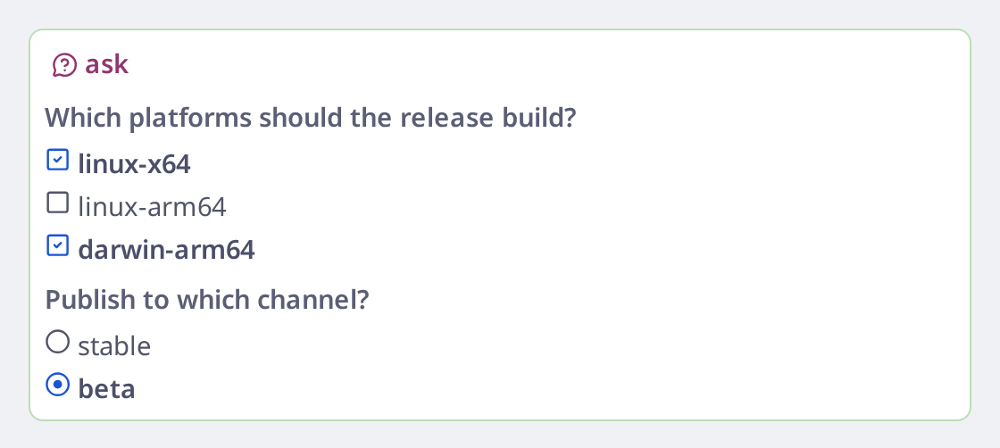</picture></td>
<td valign="top" width="50%"><b>Read</b><br>File excerpts with line numbers and highlighting.<br><br><picture><source media="(prefers-color-scheme: dark)" srcset="docs/screenshots/tool-read-dark.webp">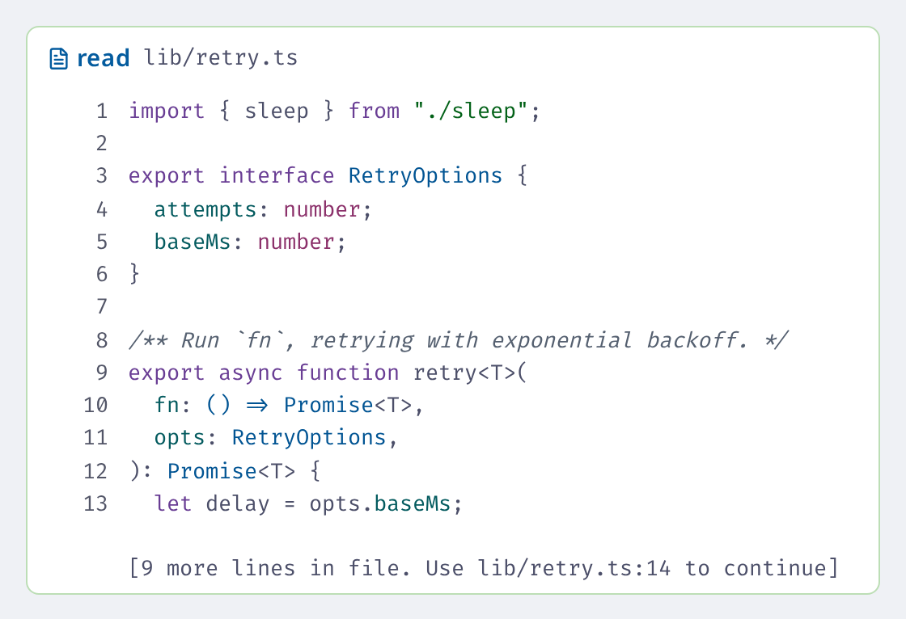</picture></td>
</tr>
<tr>
<td valign="top" width="50%"><b>Edit</b><br>Every hunk as a syntax-highlighted diff.<br><br><picture><source media="(prefers-color-scheme: dark)" srcset="docs/screenshots/tool-edit-dark.webp">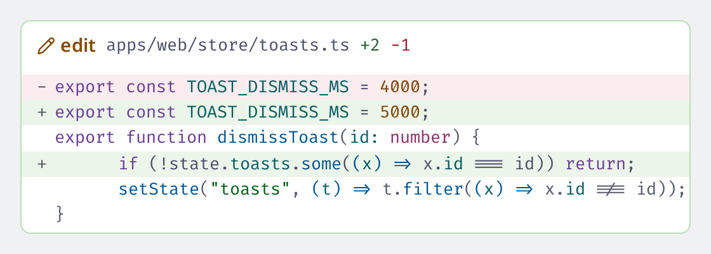</picture></td>
<td valign="top" width="50%"><b>Write</b><br>New files shown as their full content.<br><br><picture><source media="(prefers-color-scheme: dark)" srcset="docs/screenshots/tool-write-dark.webp">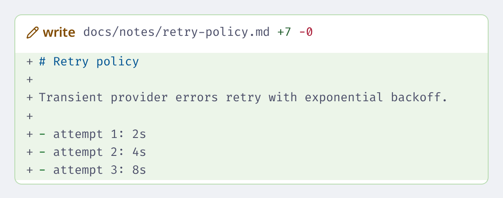</picture></td>
</tr>
<tr>
<td valign="top" width="50%"><b>Bash</b><br>The command, highlighted, with its output.<br><br><picture><source media="(prefers-color-scheme: dark)" srcset="docs/screenshots/tool-bash-dark.webp">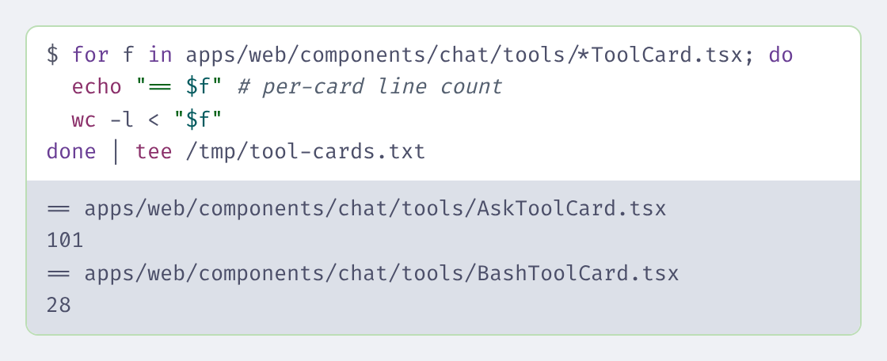</picture></td>
<td valign="top" width="50%"><b>Eval (JS)</b><br>Cells with printed tables and the helper log.<br><br><picture><source media="(prefers-color-scheme: dark)" srcset="docs/screenshots/tool-eval-js-dark.webp">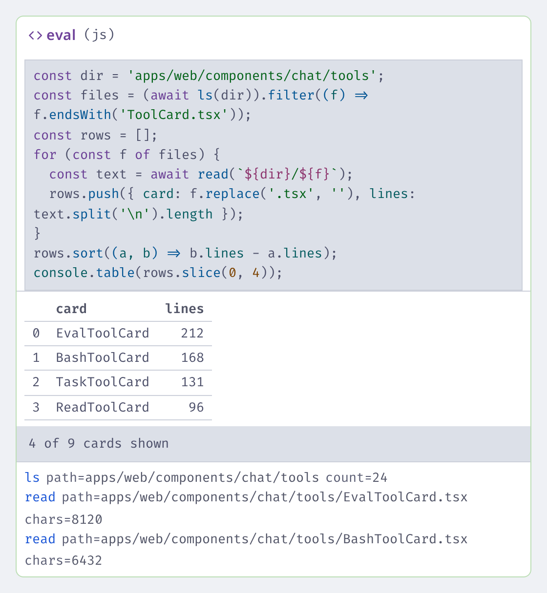</picture></td>
</tr>
<tr>
<td valign="top" width="50%"><b>Eval (Python)</b><br>DataFrames, dicts and Markdown rendered as views.<br><br><picture><source media="(prefers-color-scheme: dark)" srcset="docs/screenshots/tool-eval-python-dark.webp">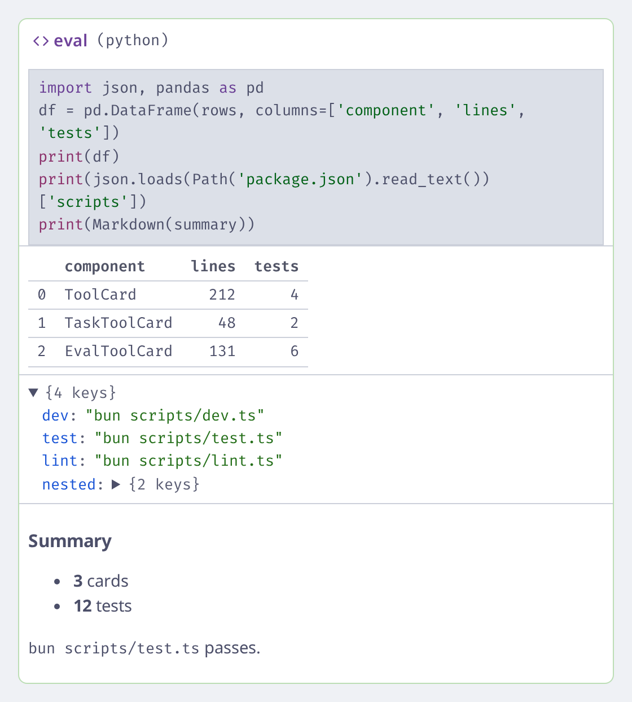</picture></td>
<td valign="top" width="50%"><b>Search</b><br>grep and find matches grouped by directory and file.<br><br><picture><source media="(prefers-color-scheme: dark)" srcset="docs/screenshots/tool-search-dark.webp">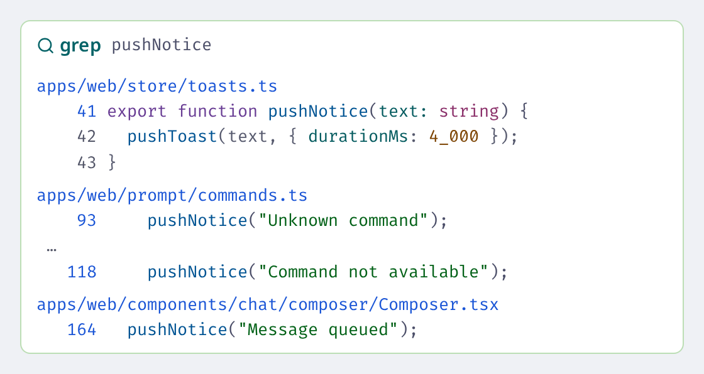</picture></td>
</tr>
<tr>
<td valign="top" width="50%"><b>LSP</b><br>Answers from the language server, such as every reference to a symbol.<br><br><picture><source media="(prefers-color-scheme: dark)" srcset="docs/screenshots/tool-lsp-dark.webp">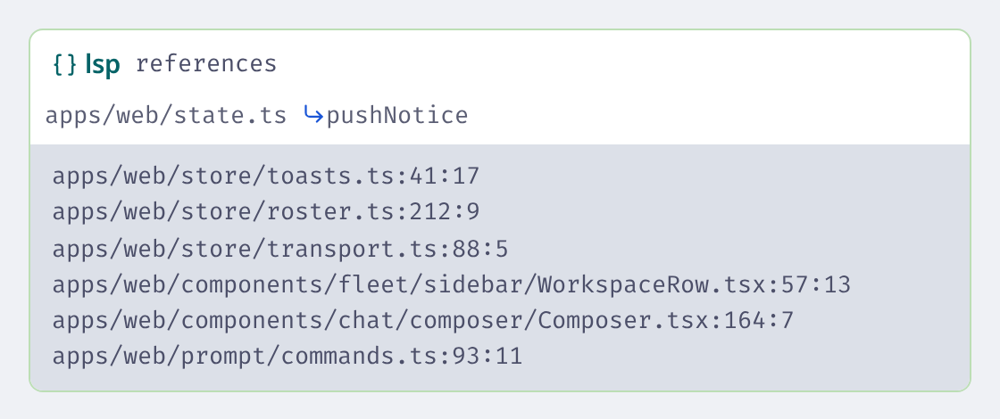</picture></td>
<td valign="top" width="50%"><b>Web search</b><br>The sources the agent found.<br><br><picture><source media="(prefers-color-scheme: dark)" srcset="docs/screenshots/tool-web-search-dark.webp">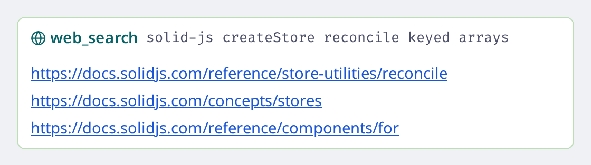</picture></td>
</tr>
<tr>
<td valign="top" width="50%"><b>Task</b><br>Subagents with run time, tokens and cost.<br><br><picture><source media="(prefers-color-scheme: dark)" srcset="docs/screenshots/tool-task-dark.webp">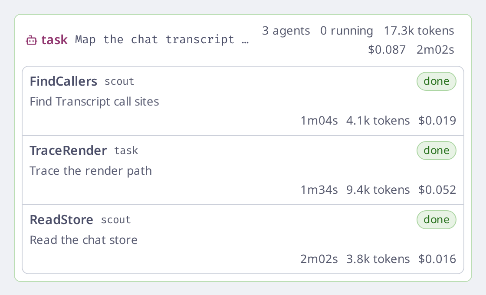</picture></td>
<td valign="top" width="50%"><b>Todo</b><br>The agent's phased task list.<br><br><picture><source media="(prefers-color-scheme: dark)" srcset="docs/screenshots/tool-todo-dark.webp">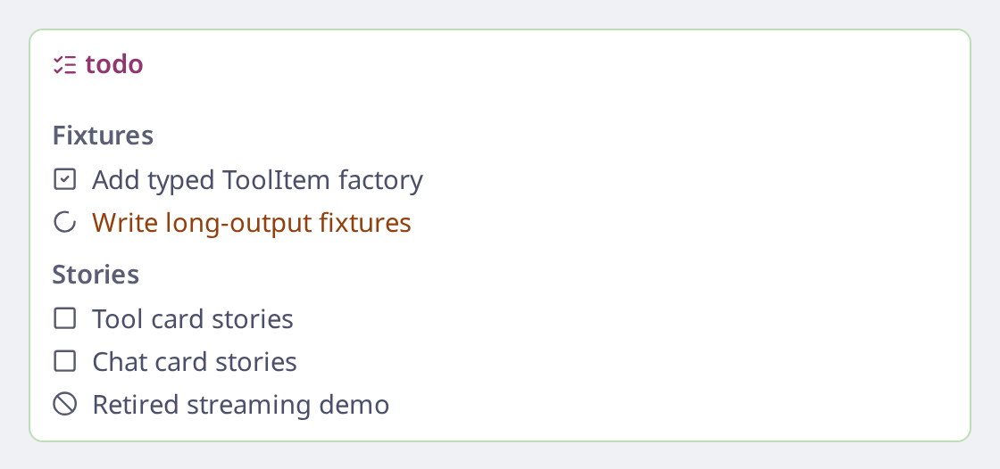</picture></td>
</tr>
<tr>
<td valign="top" width="50%"><b>Wait</b><br>What the agent is waiting on, live.<br><br><picture><source media="(prefers-color-scheme: dark)" srcset="docs/screenshots/tool-wait-dark.webp">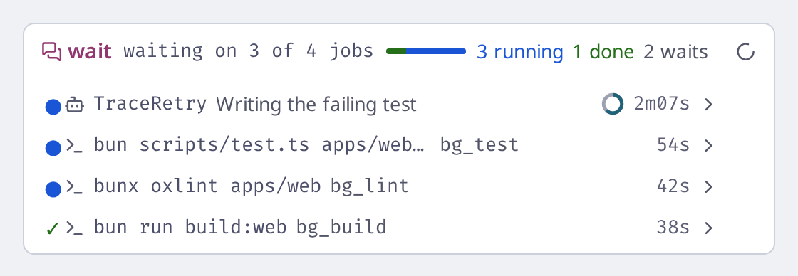</picture></td>
<td width="50%"></td>
</tr>
</table>

### The rest of the UI

<table>
<tr>
<td valign="top" width="50%"><b>Rendered answers</b><br>Markdown with tables and highlighted code, as the agent streams it.<br><br><picture><source media="(prefers-color-scheme: dark)" srcset="docs/screenshots/transcript-markdown-dark.webp">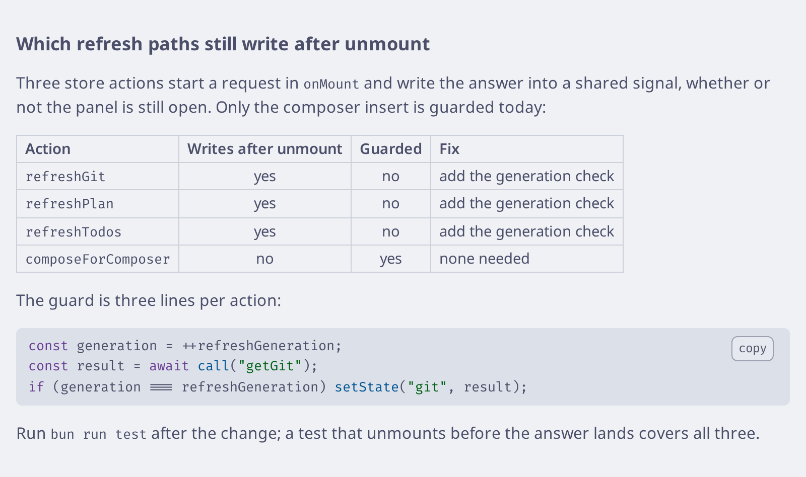</picture></td>
<td valign="top" width="50%"><b>Composer</b><br>Slash commands, <code>@</code> file mentions, prompt history and image paste.<br><br><picture><source media="(prefers-color-scheme: dark)" srcset="docs/screenshots/composer-autocomplete-dark.webp">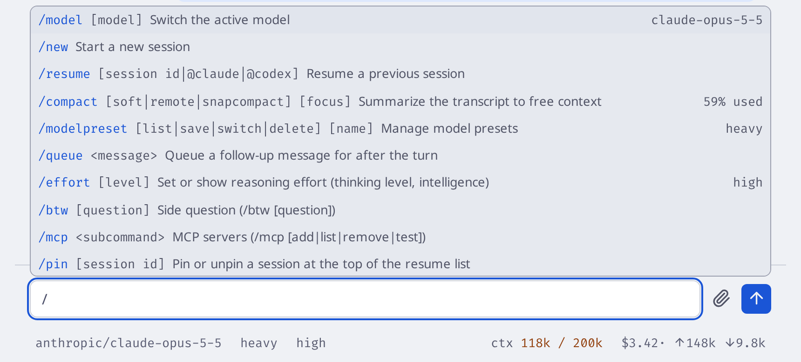</picture></td>
</tr>
<tr>
<td valign="top" width="50%"><b>Models</b><br>Presets, roles and every model your providers offer (Alt+M).<br><br><picture><source media="(prefers-color-scheme: dark)" srcset="docs/screenshots/model-presets-dark.webp">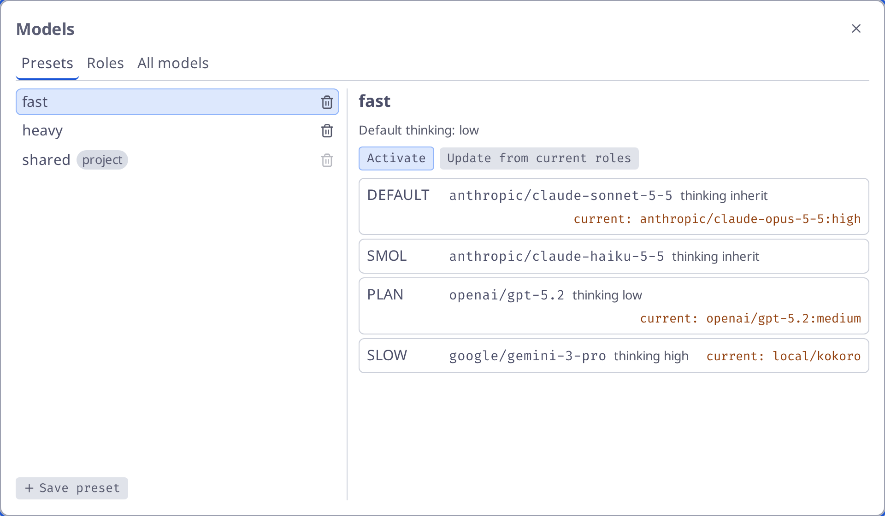</picture></td>
<td valign="top" width="50%"><b>Usage</b><br>Rate-limit windows for every provider account, beside your sessions.<br><br><picture><source media="(prefers-color-scheme: dark)" srcset="docs/screenshots/sidebar-usage-dark.webp">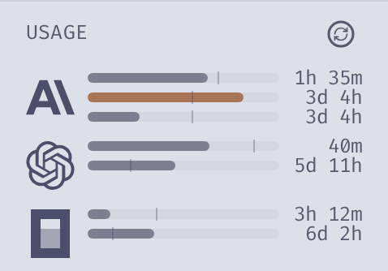</picture></td>
</tr>
<tr>
<td valign="top" width="50%"><b>Settings</b><br>omp's own settings, searchable (Ctrl+,).<br><br><picture><source media="(prefers-color-scheme: dark)" srcset="docs/screenshots/settings-dark.webp">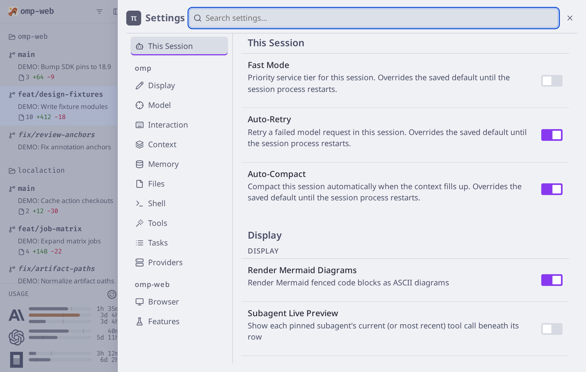</picture></td>
<td valign="top" width="50%"><b>Extensions</b><br>Skills, MCP servers and plugins for the session.<br><br><picture><source media="(prefers-color-scheme: dark)" srcset="docs/screenshots/extensions-dark.webp">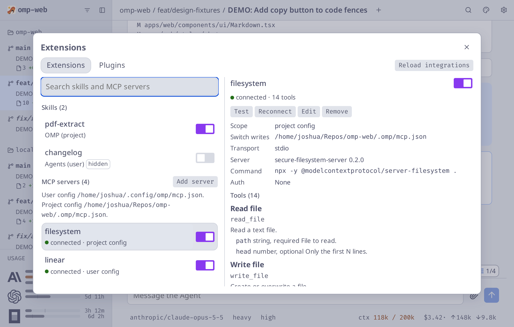</picture></td>
</tr>
<tr>
<td valign="top" width="50%"><b>Appearance</b><br>Light, dark or system, text size and transcript density.<br><br><picture><source media="(prefers-color-scheme: dark)" srcset="docs/screenshots/appearance-dark.webp">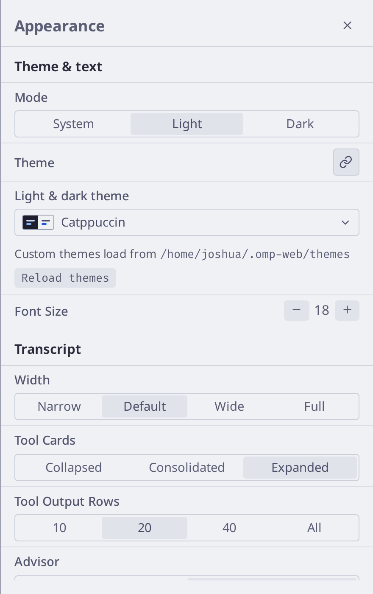</picture></td>
<td valign="top" width="50%"><b>Themes</b><br>Built-in themes with light and dark variants, plus your own files.<br><br><picture><source media="(prefers-color-scheme: dark)" srcset="docs/screenshots/theme-picker-dark.webp">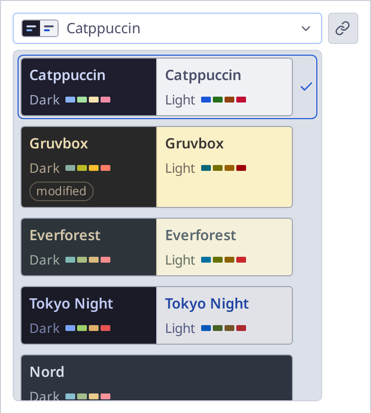</picture></td>
</tr>
<tr>
<td colspan="2" valign="top" width="100%"><b>The same session in every built-in theme</b><br><br><picture><source media="(prefers-color-scheme: dark)" srcset="docs/screenshots/themes-grid-dark.webp">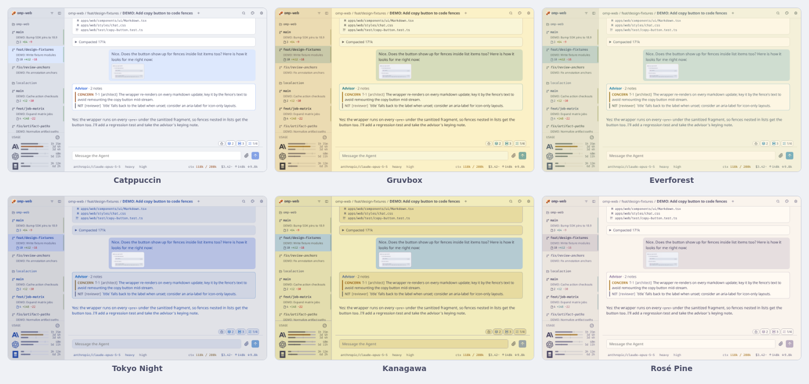</picture></td>
</tr>
</table>

## Architecture

<picture><source media="(prefers-color-scheme: dark)" srcset="docs/screenshots/architecture-dark.svg">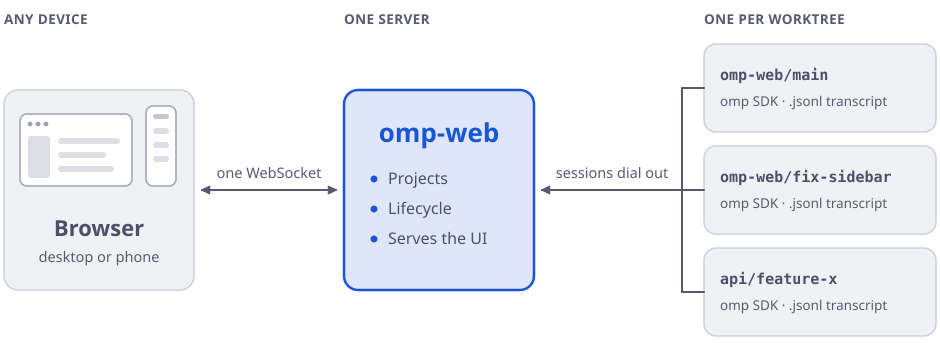</picture>

Each session is its own process, bound to one worktree and running the omp SDK in-process. Sessions dial out to omp-web, so omp-web holds no agent state: the session `.jsonl` transcript is the durable truth, and sessions keep running while omp-web restarts. See [Architecture](https://nibblebot.github.io/omp-web/docs/architecture/) for the protocols.

### Split form

The same fleet can run as two processes on one host: `omp-web control` runs the control plane alone (projects and session lifecycle, port 4722 by default), and `omp-web ui` serves the web UI and proxies its API calls and browser WebSocket to the control plane over loopback (port 4723 by default). See [Running omp-web](https://nibblebot.github.io/omp-web/docs/running/).

<picture><source media="(prefers-color-scheme: dark)" srcset="docs/screenshots/architecture-split-dark.svg">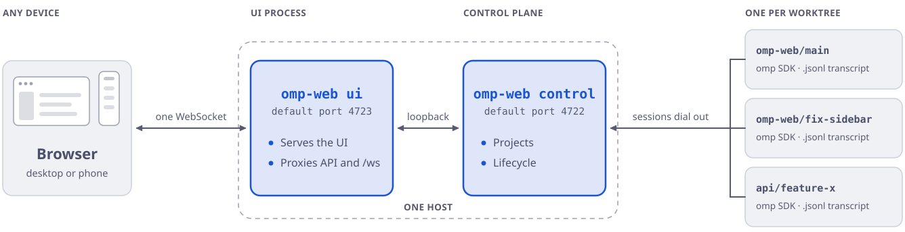</picture>

## Try the live demo

**[Open the live demo](https://nibblebot.github.io/omp-web/demo/)**: the real omp-web interface, built from the same components as the app, running entirely in your browser against fixture data. Nothing to install, no account, no model calls. In it you can:

- send a prompt and watch the reply stream in, with tool cards and subagents
- open the Activities panel (Alt+A), the command palette (Ctrl+K), the model picker (Alt+M) and Settings (Ctrl+,)
- switch themes and light or dark mode from Appearance
- narrow the window to get the phone layout
- hold Shift to label the component under the pointer, or Ctrl+Shift to label them all, and click a label to inspect that component

## Install and run

You need [Bun](https://bun.sh) 1.4.4 or newer (the installer adds it when missing) and the `omp` CLI with a model and credentials configured (run `omp` once, or `omp login`).

```sh
curl -fsSL https://raw.githubusercontent.com/nibblebot/omp-web/main/scripts/install.sh | sh
```

Then check the install and start omp-web:

```sh
omp-web --version
omp-web            # starts the fleet and opens http://localhost:4722
```

Add a project from the sidebar, start a session on one of its worktrees and send a prompt. `omp-web update` installs new releases.

More in the docs: [Installation](https://nibblebot.github.io/omp-web/docs/installation/), [Running omp-web](https://nibblebot.github.io/omp-web/docs/running/), [CLI reference](https://nibblebot.github.io/omp-web/docs/cli-reference/), [Configuration](https://nibblebot.github.io/omp-web/docs/configuration/), [Custom themes](https://nibblebot.github.io/omp-web/docs/configuration/custom-themes/), [Optional features](https://nibblebot.github.io/omp-web/docs/configuration/features/).

## omp-web and the omp TUI

|omp-web|omp TUI|
|---|---|
|Many sessions across repos and worktrees in one window|One session per process|
|Register projects; create and delete worktrees from the sidebar|`omp worktree` command; `/wt` moves the current session|
|Sessions keep running when the browser closes; reattach from any device|The session ends with its terminal|
|Idle sessions sleep and wake on demand; crashed sessions restart with backoff|No (subagents only: park after idle, revive on demand)|
|One Ctrl+K palette over commands, sessions, settings and models|A separate picker for each: `/`, Alt+M, `/resume`, `/settings`|
|Usage for every account in the sidebar, always visible|`/usage` dashboard; an optional status-line segment shows only the active account (off by default)|

Still TUI-only: voice (`/live`), `/login`, `/stats`, `/trace`, `/move` and `/wt`, Plan Mode, Git Review and editable todos.

## Contributing

See [CONTRIBUTING.md](CONTRIBUTING.md) for development and checks, and [AGENTS.md](AGENTS.md) for the engineering map.
