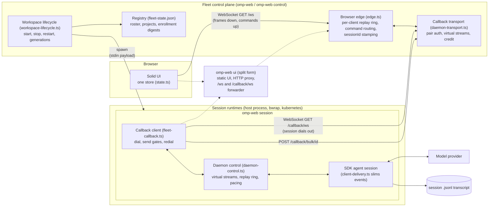
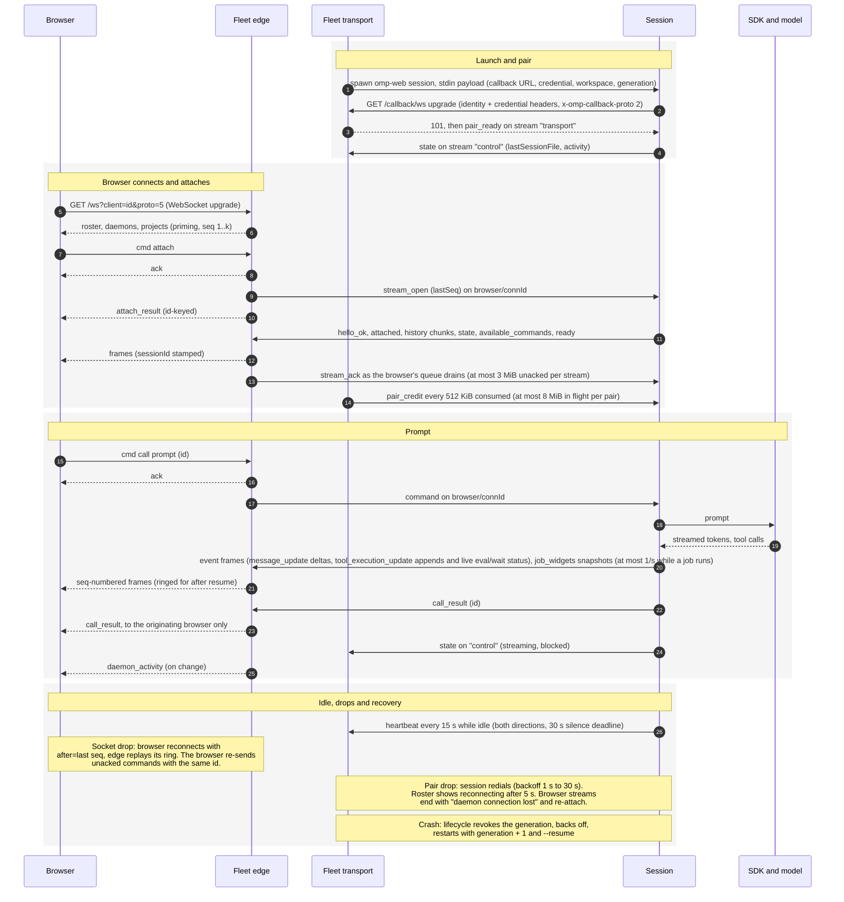

# Architecture: browser, fleet, session

omp-web has three tiers. The **browser** runs the Solid UI. The **fleet** (`omp-web`, or `omp-web control`) is the control plane: roster, workspace lifecycle, and the browser edge. Each **session** (`omp-web session`) is one daemon process that runs one in-process SDK agent against one project directory. The durable record of what an agent did is the session's `.jsonl` transcript; the fleet holds no agent state.

There are two protocol hops, versioned separately:

| Hop | Transport | Version | Source of truth |
|---|---|---|---|
| Browser to fleet | One WebSocket, `GET /ws`: frames down, commands up, acks and nacks | `OMP_PROTO` 5 | `lib/wire/browser-socket.ts`, `lib/wire/protocol.ts` |
| Fleet to session (the callback pair) | One WebSocket, `GET /callback/ws`, dialed by the session; `POST /callback/bulk/<id>` for large transfers | `OMP_CALLBACK_PROTO` 2 | `lib/wire/callback-protocol.ts` |

## Components

- **The fleet never dials a session.** Every session dials out to `/callback/ws` with its workspace id, generation, connection id, credential and protocol version in the upgrade headers. That way a session can run on the fleet host, in a bwrap sandbox, or in a pod behind NAT. In the split form (`omp-web ui` in front of `omp-web control`), the UI process forwards the browser routes, the browser socket (`/ws`) and the session WebSocket to the control plane on loopback.
- **Each launch gets a fresh credential.** The lifecycle mints a new credential and generation for every launch and passes them on stdin (`--fleet-stdin`), never in argv or the environment. The fleet stores only the credential's digest. A refused dial is upgraded and then closed with a typed code (4000 + HTTP status). The session stops for good on `unauthorized`, `invalid_identity`, `generation_obsolete` or `proto_unsupported`, and redials on anything else.
- **Virtual streams multiplex one pair.** `transport` carries the fleet's own controls (`pair_ready`, `pair_credit`, heartbeats). `control` carries the session's state mirror, which the fleet taps for roster activity. Each attached browser gets its own `browser/<connId>` stream.
- **The session primes every stream it is asked to open.** The edge relays those frames to the browser's socket, stamping `sessionId`. Answers to commands go only to the browser socket that sent them. The upgrade is origin-checked when browser auth is on, which is what stands in for a per-command CSRF token.

## One session's life over time

This is a sequence diagram. Arrows between the edge and the session travel over the pair, through the fleet transport. The transport is drawn only where it acts on its own: pairing, credit and heartbeats.

## Flow control

Four bounds keep any slow party from holding unbounded memory elsewhere:

| Bound | Size | Who enforces it | Effect |
|---|---|---|---|
| Socket send high-water mark | 1 MiB | Each sender | No more messages go to the socket while its buffer is above this. The rest waits in the sender's bounded queue (8 MiB per pair, 4 MiB per stream). |
| Pair credit window | 8 MiB | Fleet grants `pair_credit` as it consumes | A session never has more than 8 MiB on the wire unconsumed. The fleet closes a pair that exceeds it. This also bounds what `omp-web ui` or a reverse proxy holds for one pair. |
| Browser socket buffer | 4 MiB | Edge, before each send to a browser | A socket whose buffered bytes pass this, whose send is dropped, or that has no drain for 30 s is closed 4503; the browser resumes with `after`. |
| Stream ack window | 3 MiB | Edge sends `stream_ack` as the browser's queue drains | History priming is paced by the slowest reader on that stream only. A browser with no drain for 30 s is dropped and resumes with `after`. |

## Where to read next

- `lib/wire/protocol.ts` and `lib/wire/callback-protocol.ts`: frame and envelope shapes, constants, and the header comments that define each hop.
- `lib/wire/browser-socket.ts`: the browser socket wire (query, messages, close codes, keepalive).
- `apps/fleet/edge.ts`: browser routing, priming, ring and backpressure rules.
- `apps/fleet/daemon-transport.ts` and `apps/session/fleet-callback.ts`: the two halves of the pair.
- `docs/provider-protocol.md`: how runtime providers launch clones that dial this pair.
- `scripts/profile/results/`: measurements behind the transport choices.
